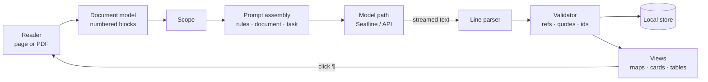

# Analysis Pipeline

Version: 0.1  
Established: 2026-10-13  
Status: C/D implement the readers and [analysis engine](analysis-engine.md); E supplies the workspace/views; F supplies versioned prompts and the [evaluation harness](phase-one-evaluation.md). Live quality/Phase 1 acceptance remain open. A-slice draft probes remain separately source-labelled. This document defines the path-neutral engine, from extracted text to rendered views. How turns reach models is covered in [model paths](model-paths.md) and [Seatline integration](seatline-integration.md).

## Overview



1. A reader extracts text into numbered blocks.
2. The reader chooses a scope, and the prompt is assembled in three layers.
3. A model path runs the turn and streams text back.
4. The text arrives as JSON Lines. Each complete line is parsed, validated against the document, stored, and drawn at once.
5. Every reference in a view leads back to the paragraph it cites.

## Document model

### Blocks and paragraph numbers

A document is an ordered list of blocks:

| Field | Meaning |
| --- | --- |
| `n` | Paragraph number (¶), 1-based, in reading order across the whole document |
| `kind` | `para`, `heading`, `quote` (block quotation), `list`, `caption`, `note` (footnote or endnote), `table` |
| `level` | Heading level, for headings |
| `text` | Normalized text: Unicode NFC, whitespace collapsed, hyphenated line breaks joined |
| `page`, `pageLabel` | PDF page index and its printed label, where one exists |
| `section` | Identifier of the innermost section containing the block |
| `anchor` | How to find the block again in the source (see below) |

- Every block gets a number, including headings and notes, so a reference can point anywhere.
- Footnotes take numbers in reading order after the body text of their page and are marked `note`.
- Numbers are fixed for a given extraction. They never change under a saved run.

### Sections

Sections form a tree built from the PDF outline when one exists. Otherwise they come from headings: HTML `h1`–`h6`, or PDF lines that stand out by font size and position. A section records its title, level, first and last ¶ and, for PDFs, its page range. Chapters are the sections at the level the reader treats as chapters, which is chosen automatically and can be changed.

### Anchors

- **Web pages:**
  - Each block stores a text-quote selector (exact text plus a short prefix and suffix), a text-position offset and the DOM path of its element, in the manner of the W3C Web Annotation selectors.
  - On load, blocks are resolved by DOM path first and by text quote when the page has changed.
  - Highlights are drawn with the CSS Custom Highlight API, which leaves the page's DOM untouched.
- **PDFs:** each block stores its page and the range of PDF.js text items it came from. The reader scrolls to the page and draws the highlight from the items' rectangles.

### Versions

Extraction has a version: a hash of the source's identity, its content and the extractor version.

- If a page changes, a new extraction version is created.
- Earlier runs keep their own version and are marked stale.
- Their anchors still resolve wherever the quoted text survives.

## Scopes

| Scope | Blocks |
| --- | --- |
| Selection | Blocks that overlap the selection, with context blocks around them: the section heading, two blocks before and one after, marked as context |
| Section or chapter | The section's ¶ range |
| Page range (PDF) | Blocks whose page falls in the range |
| Document | All blocks; larger than one request on most paths, so it runs as a [long-text job](#long-texts) |

Before a run, the panel shows the scope's size:

- an estimated token count;
- on Seatline, the request's byte size against the 1 MiB frame limit.

## Prompt assembly

### Three layers

1. **Rules.** Stable and versioned, the same for every lens. They cover:
   - Sharh's role;
   - the rule that the document is data and holds no instructions;
   - the reference rules (cite ¶, never invent numbers);
   - the *stated* and *inferred* labels;
   - the quotation rule (exact words only);
   - the general JSON Lines rules;
   - the output language rule.
2. **Document.** The numbered blocks of the scope.
3. **Task.** The lens instructions:
   - the record types allowed for this lens, with their fields and enumerations;
   - the output language and length budget;
   - any focus or theoretical frame the reader added.

The document comes before the task, so runs on the same scope share the longest possible prefix. That matters for session reuse on Seatline and for prompt caching on the API path.

### How the document is written into the prompt

```
<document title="Print and the Making of Publics" lang="en" scope="Chapter 3, pp. 45–78">
¶40 [heading 2] 3.1 The pamphlet economy
¶41 [p. 45] In the decades after 1640, the number of printed pamphlets…
¶42 [p. 46] Printers depended on…
¶43 [p. 46] [note] See Raymond, Pamphlets and Pamphleteering…
</document>
```

- Headings keep paragraph numbers and an explicit heading level, as all other blocks do. Structure records cite the ¶ ranges of sections. D and the A-03 draft probe serialize these same fields as a JSON document object, so source text cannot close a document delimiter; D uses `n` for ¶ and retains source metadata and selection offsets.
- Context blocks for selection tasks are marked `[context]`, and the selection is marked `[selected]`.
- The opening tag carries the document's language when it is known, so the model does not have to guess between, for example, Uzbek Latin and Turkish.

### Placement on a path

- **Seatline:**
  - `turn.system` carries the rules, and the first user message carries the document followed by the task.
  - On a continued session, later turns carry only the next task, with `system` set to null.
  - Seatline puts `system` at the start of the prompt for Claude and Codex ([details](seatline-integration.md#turn-mapping)).
- **API (later):** the rules go in the system prompt, the document goes in the first user content block, and the task in a following block. The cache boundary sits after the document.

## Output contract (JSON Lines)

Every lens answers in JSON Lines: one JSON object per line. The format streams well, since each line can be shown as soon as it is complete. It survives imperfect output, since a bad line costs that line, not the run. It also works the same on every path.

### General rules

- One object per line, UTF-8, with no prose and no Markdown fences. The parser tolerates fences and stray prose anyway.
- **Type:** every record has a type field `t`.
- **Identifiers:** `id` values are short strings, unique within the run (`s1`, `c4`). They are referenced by `parent`, `from`, `to`, `theme` and `code`.
- **References:**
  - `refs` lists ¶ numbers (integers) from the document as given.
  - `span` is `[first, last]` for a range.
  - Records that rest on the text must have at least one reference.
- **Basis:** `basis` is `"stated"` or `"inferred"` on interpretive records.
- **Quotations:** `quote` holds exact words from a cited paragraph, kept short (400 characters at most). An omission inside a quotation is written `…`.
- **Language:**
  - Text fields are in the output language.
  - `src` fields keep the source language.
- **End:** the last line is `{"t":"end"}`. Without it, the run counts as truncated.

### Record types

| `t` | Fields | Meaning |
| --- | --- | --- |
| `meta` | `lens`, `lang` | Optional first line: which lens, which output language |
| `sum` | `level` (`line`, `abstract`, `section`, `brief`), `sec`?, `text`, `refs` | A summary at one depth. `brief` is the before-you-read briefing. |
| `arc` | `n`, `stage`, `text`, `refs` | One stage of the synopsis |
| `sec` | `id`, `parent`?, `title`, `role`, `gist`, `span` | A structural part and what it does |
| `node` | `id`, `kind`, `text`, `refs`, `basis`, `quote`? | An element of the argument |
| `edge` | `from`, `to`, `rel`, `text`? | A relation between nodes or concepts |
| `step` | `n`, `text`, `refs` | One step in the narrated logical flow |
| `gap` | `kind`, `at` (ids), `text`, `refs` | A weakness in the argument |
| `facet` | `kind`, `text`, `refs`, `basis` | One facet of a reading: thinking, meta-reading or critique |
| `concept` | `id`, `term`, `src`?, `gloss`, `refs` | A key concept as this text uses it |
| `theme` | `id`, `label`, `text`, `refs` | A theme |
| `code` | `id`, `theme`, `label`, `text` | A code under a theme |
| `excerpt` | `code`, `ref`, `quote` | A coded excerpt |
| `tension` | `a`, `b`, `text`, `refs` | A tension between two themes or codes |
| `memo` | `text` | An analytic memo |
| `cite` | `who`, `work`?, `role`, `text`, `refs` | A cited author or work and how the text uses it |
| `term` | `src`, `tr`, `text`, `refs` | A glossary entry: source term, translation, meaning here |
| `q` | `level`, `text`, `refs` | A study question |
| `chk` | `part`, `text`, `refs`, `basis`? | One part of an argument check: `claim`, `reason`, `strength`, `weakness`, `assumption`, `objection` or `assessment` |
| `note` | `text`, `refs`? | Anything a lens needs to say that fits no other type |
| `finding` | `kind`, `text`, `support`, `refs` | A cross-text finding with a qualitative support note and item-mapped evidence |
| `cell` | `item`, `criterion`, `text`, `refs` | A texts-by-criteria matrix cell; every reference must belong to that library item |
| `end` | — | End of output |

### Enumerations

| Field | Values |
| --- | --- |
| `arc.stage` | `opening`, `problem`, `development`, `turn`, `resolution` |
| `sec.role` | `context`, `question`, `definition`, `claim`, `evidence`, `example`, `objection`, `rebuttal`, `concession`, `method`, `synthesis`, `transition`, `conclusion` |
| `node.kind` | `premise`, `evidence`, `inference`, `claim`, `conclusion`, `objection`, `rebuttal`, `assumption`, `definition` |
| `edge.rel` in Logic | `supports`, `attacks`, `qualifies`, `elaborates`, `exemplifies`, `presupposes` |
| `edge.rel` in Thinking | `causes`, `enables`, `constrains`, `opposes`, `part_of`, `instance_of`, `depends_on` |
| `gap.kind` | `unstated_premise`, `leap`, `circularity`, `equivocation`, `overgeneralization`, `false_dichotomy`, `missing_evidence`, `other` |
| `facet.kind` in Thinking | `question`, `evidence_standard`, `reasoning_mode`, `assumption`, `worldview`, `lineage`, `normative`, `blind_spot`, `falsifier` |
| `facet.kind` in Meta-reading | `genre`, `audience`, `purpose`, `position`, `context`, `framing`, `silence` |
| `facet.kind` in Critique | `strength`, `weakness`, `evidence_quality`, `counterargument` |
| `cite.role` | `foundation`, `foil`, `method`, `evidence`, `context`, `ally` |
| `q.level` | `comprehension`, `analysis`, `evaluation`, `debate` |

An unknown value becomes `other` where the field allows it. Otherwise the record is dropped and counted.

### Records per lens

| Lens | Records |
| --- | --- |
| Summary | `sum`, `arc`, `note` |
| Structure | `sec`, `note` |
| Logic | `node`, `edge`, `step`, `gap`, `note` |
| Thinking | `facet`, `concept`, `edge`, `node` (for the causal chain), `note` |
| Themes | `theme`, `code`, `excerpt`, `tension`, `memo` |
| Meta-reading, Critique | `facet`, `note` |
| Literature | `cite`, `facet`, `note` |
| Terms | `term` |
| Questions | `q` |
| Argument check | `chk` (at most one `claim`, three `reason`, one `strength`, one `weakness`, two `assumption`, one `objection` and one `assessment`; the parser drops the rest) |
| Passage actions | `note`, `term`, `node` |
| Chapter digest (internal) | `sum` (section level), `node` (key claims), `concept`, `cite`, `facet` (`question`, `reasoning_mode`) |

Every lens may emit `meta` first and must end with `end`. Custom lenses choose from the same types.

### Example (Logic)

```
{"t":"meta","lens":"logic","lang":"en"}
{"t":"node","id":"p1","kind":"premise","text":"Cheap print lowered the cost of reaching readers outside the court.","refs":[41],"basis":"stated"}
{"t":"node","id":"c1","kind":"claim","text":"Pamphlets created a public that judged political claims for itself.","refs":[52],"basis":"stated","quote":"a public that learned to judge"}
{"t":"node","id":"a1","kind":"assumption","text":"Reading a pamphlet implies evaluating it rather than absorbing it.","refs":[52,53],"basis":"inferred"}
{"t":"edge","from":"p1","to":"c1","rel":"supports"}
{"t":"edge","from":"a1","to":"c1","rel":"presupposes"}
{"t":"gap","kind":"unstated_premise","at":["p1","c1"],"text":"Access to pamphlets is treated as engagement with them.","refs":[41,52]}
{"t":"end"}
```

## Parsing and validation

Validation runs line by line as text streams in. A record is drawn as soon as it passes.

1. **Framing:** text is split on newlines. Empty lines, Markdown fences and lines that do not start with `{` are skipped and counted.
2. **Parsing:** `JSON.parse`; anything that is not an object is dropped.
3. **Type:** `t` must be allowed for the lens.
4. **Fields:**
   - required fields must be present with the right types; optional null/blank values are omitted;
   - enumerations must be valid;
   - strings are capped (`text` at 1,200 characters, `quote` at 400) and stripped of control characters.
5. **References:**
   - numbers outside the scope are removed;
   - a record that requires references and has none left is kept but shown as *unanchored*.
6. **Quotations:**
   - Each `quote` is checked against the cited paragraph, and against its neighbours, since a quotation may cross a paragraph break.
   - Before matching, both sides are normalized:
     - NFC;
     - collapsed whitespace;
     - one form for each family of quotation marks, apostrophes (including the Uzbek ʻ variants) and dashes;
     - soft hyphens removed.
   - A quotation containing `…`, `...` or `. . .` matches when its parts appear in order.
   - A failing quotation is removed from the record, and the record is marked *quotation not found*.
7. **Identifiers:**
   - Duplicate ids are renamed.
   - References to ids not yet seen wait until `end`, then dangling ones are dropped.
   - Parent cycles in `sec` are broken.
8. **Completion:** without `end`, the run is marked truncated and offers *continue*. End-only output is valid when there is nothing more to report. Trailing chatter is counted without forcing repair or continuation. On a session, continuation sends the next task and a short tail; elsewhere it is a new run with compact history. The complete outgoing frame is checked before allocating a new version; `TOO_LARGE` is not offered for continuation.
9. **Repair:**
   - If fewer than 80% of record lines are valid, or none are and the output is not a clean empty completion, Sharh makes one repair turn.
   - The repair turn sends the faulty output (not the document) and the contract, and asks for the same content in the right form.
   - The repaired output goes through validation again and replaces the first attempt only if it validates and preserves at least its valid-record count. Retained history is seeded locally, outside the repair output cap.

Each run stores its metrics:

- lines, valid records and records dropped by reason;
- references removed;
- quotations verified and failed;
- truncation;
- time to first record and to completion;
- the token usage the path reported.

These metrics drive the [quality targets](../product/sharh-product-framework.md#quality-and-evaluation).

## Long texts

A chapter is sent whole. A whole book is not: it would exceed request limits on most paths (Seatline's frame is 1 MiB) and the models' context. Book-level work therefore runs in two steps.

1. **Digest each chapter.**
   - An internal digest lens produces compact records: section summaries, key claims with references, concepts, citations, the chapter's question and its mode of reasoning.
   - Digests are stored by extraction version, chapter span, prompt version and model.
2. **Synthesize.**
   - Book-level lenses read the digests, which keep chapter titles and ¶ ranges, instead of the full text.
   - References stay global ¶ numbers, so jumps still land in the book.

The job runner digests chapters in order, saves each digest as it completes and resumes from the first missing one. It paces itself by the path's rules (on Seatline, at most one background turn, so the reader's own requests do not wait behind the job; see [pacing](seatline-integration.md#scheduling-and-pacing)). If a seat reaches its usage limit, the job continues on the next one in the reader's failover order. Each digest records the model that wrote it, and the synthesis step uses a single model.

The H implementation and its stricter zero-output failover boundary are detailed in [Across texts](across-texts.md). Partial or ambiguous chapters stop for explicit continuation. Collection projections preserve original item/extraction/paragraph provenance, and glossary snapshots are part of prompt identity.

## Chat answers

Ask answers in Markdown rather than JSON Lines.

- **References:** they are written `[¶12]` or `[¶12–14]` and become links. A reference outside the scope is shown as unverified.
- **Rules:** answer from the scope, say when the text does not address the question, and separate what the text says from what the model infers.
- **Rendering:** Markdown is rendered through a sanitizer, and no raw HTML from the model reaches the page.

## Second reader alignment

Both readers run the same lens on the same scope with the same prompts, in separate sessions. Neither sees the other's output.

- **Themes:**
  - Each theme's paragraph set is the union of its references and its excerpts' references.
  - Themes from A and B are paired by the highest Jaccard similarity of those sets, one to one, above a threshold (0.3 by default).
  - A pair's agreement is its Jaccard similarity, and an unpaired theme belongs to one reader only.
  - At paragraph level, each paired theme yields percent agreement and Cohen's kappa over the scope's paragraphs. Kappa is shown only when the scope has at least 20 paragraphs.
- **Logic:**
  - Nodes are paired by overlapping references and compatible kinds.
  - Edges are compared between paired nodes.
  - The result lists what both found, what only one found, and contradictions (A supports where B attacks).
- **Reconciling:**
  - The reader settles disagreements in a side-by-side view, and the result is saved as a reconciled run.
  - An optional merge suggestion is one cheap turn that receives both outputs, not the document.

## Storage

Everything is kept in IndexedDB, with settings in `chrome.storage.local` (never `sync`).

| Store | Key | Holds |
| --- | --- | --- |
| `docs` | document id | Source address or file name, title, kind, language, extraction version |
| `extractions` | document id, extraction version | Retained extraction metadata |
| `sources` | document id, extraction version | Saved HTML or PDF bytes |
| `blocks` | document id, extraction version, ¶ | Block fields and anchors |
| `sections` | document id, extraction version, section id | Section tree |
| `runs` | run id | Document, lens, scope, path, provider, model, effort, prompt version, status, metrics, time |
| `records` | run id, sequence | Validated records and their flags |
| `chats` | chat id | Document, scope, path, provider, session token, messages |
| `collections` | collection id | Library items and their order |
| `glossary` | book id, term | Source term, chosen translation, note |
| `jobs` | job id | Long-text job steps and state |
| `maintenance` | intention id | Deduplicated Seatline forget/cleanup intentions; dispatched by D-05 |

Deleting a document atomically deletes all extraction versions, blocks, sections, source files, runs, records, chats, jobs and glossary rows, and removes its collection memberships. It also schedules Seatline `forget` for their sessions and `cleanup` for their groups ([sessions](seatline-integration.md#sessions-forget-and-cleanup)). Export writes portable document data to one JSON file, excluding settings, maintenance and live session/cleanup bindings. PDF bytes use base64. Import adds validated data atomically; identical rows are accepted and conflicting rows abort the import. C stores deduplicated Seatline maintenance intentions; D-05 dispatches them through the worker on activation and after deletion, retaining failed intentions for retry.

## Views

| Records | View |
| --- | --- |
| `sec` | Collapsible outline and a tree mind map coloured by `role` |
| `node`, `edge`, `gap`, `step` | Layered argument graph (premises toward conclusions, objections in a contrasting colour, gaps as dashed links), with the step list kept in sync |
| `concept`, `edge` (Thinking), `facet` | Concept map (force layout), causal chain and facet cards |
| `theme`, `code`, `excerpt`, `tension`, `memo` | Codebook table with excerpts, tensions and memos |
| `sum`, `arc` | Summary cards and the arc timeline |
| `cite`, `term`, `q`, `facet` | Tables and cards |

- **Rendering as records arrive:**
  - Records render as they arrive.
  - Graph layout is recomputed in steps.
  - Animation turns off above about 60 nodes.
- **Inspection:** every node shows its paragraph text and its *stated* or *inferred* label on selection.
- **Libraries:** candidates are d3-hierarchy, dagre and d3-force. They are chosen during implementation and bundled locally, since extension pages load no remote code.

## Testing the pipeline

- **Fixtures:** documents with hand-made expected structure, and recorded model outputs in JSON Lines, including malformed and truncated ones, for parser and validator tests.
- **Fake path:** a scripted path that replays recorded outputs with realistic timing, so views and validation are tested without any model.
- **Live evaluation:** each lens with each provider on the corpus, on the owner's machine, written to a JSON report of the metrics above.
