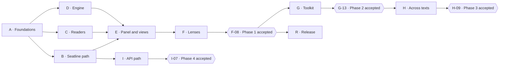

# Sharh — Implementation Tracker

Established: 2026-10-14  
Status: A–E implemented. F-01–F-06 are IMPLEMENTED — VERIFY for real-provider output quality; F-07 is DONE with scripted/pinned-broker matrices and review-form validation. F-08 is BLOCKED by live/expert and owner-machine gates. A-02/A-03/B-05/E-07 remain IMPLEMENTED — VERIFY. No live-provider behaviour is claimed.

This is the authoritative progress record. Requirements are defined in the [product framework](sharh-product-framework.md), the [analysis pipeline](../architecture/analysis-pipeline.md), [model paths](../architecture/model-paths.md) and [Seatline integration](../architecture/seatline-integration.md). When this tracker and those documents disagree, fix the disagreement in the same change.

## Progress

- Planned implementation items: **72**
- DONE: **28**
- IMPLEMENTED — VERIFY: **10**
- IN PROGRESS: **0**
- BLOCKED: **1**
- TODO: **33**

Upstream Seatline dependencies (S-items) and the repository setup record are not counted.

## Status and ownership

| Status | Meaning |
| --- | --- |
| TODO | Work has not started |
| IN PROGRESS | An owner is actively working on the item |
| BLOCKED | A named dependency prevents progress; explain it in Evidence |
| IMPLEMENTED — VERIFY | The change exists, but required acceptance validation is outstanding |
| DONE | The acceptance criterion is met with linked evidence |

Rules:

- **IDs:** keep IDs stable and never reuse one. New work takes the next free ID in its milestone.
- **Ownership:**
  - Record the owner before starting.
  - Update the status, the evidence and the progress counts in the same change.
- **Status:**
  - Use IMPLEMENTED — VERIFY while any part of an acceptance criterion is unverified. Typically that is a part marked **Live**, which needs a real provider or a real Chrome on the owner's machine.
  - Use DONE only with linked evidence: a pull request, a CI run, or a report under `docs/evidence/`.
- **Dependencies:** an item's dependencies must be DONE before it starts, unless the decision log names the accepted slice that allows it.
- **Live claims:** never claim live behaviour (latency, output quality, usage limits) without recorded evidence.
- **Seatline gaps:** a capability Seatline lacks becomes an S-item and an issue in Seatline, not a workaround in Sharh.

## Milestones

| Milestone | Outcome | Items | Phase |
| --- | --- | --- | --- |
| A | Verify the foundations: the Seatline contract and authorization, provider output compliance, extraction, the corpus and the toolchain | A-01 – A-06 | 1 |
| B | Reach models through Seatline: client, path interface, policy, setup and pacing | B-01 – B-07 | 1 |
| C | Read web pages and PDFs into an anchored document model | C-01 – C-05 | 1 |
| D | Turn model output into validated, stored records | D-01 – D-06 | 1 |
| E | Show it: panel, model picker, streaming views, jump to ¶ and the passage toolbar | E-01 – E-07 | 1 |
| F | Phase 1 lenses, passage prompts and evaluation, ending in Phase 1 acceptance | F-01 – F-08 | 1 |
| G | Scholar's toolkit | G-01 – G-13 | 2 |
| H | Across texts | H-01 – H-09 | 3 |
| I | API-key path | I-01 – I-07 | 4 |
| R | Privacy, permissions, packaging and distribution | R-01 – R-04 | — |

The milestone order is shown below. Item-level dependencies are in the tables.

## Work items

### A — Foundations and evidence

| ID | Item | Depends on | Acceptance criterion | Status | Owner | Evidence |
| --- | --- | --- | --- | --- | --- | --- |
| A-01 | Audit the Seatline consumer contract | — | Transport, methods, events, limits, capabilities, sign-in classes, session support and missing generic capabilities are recorded from a pinned revision's source | DONE | Claude | [Seatline integration](../architecture/seatline-integration.md), read from source at `ba712f7` and checked against the companion, provider and core code; no live run |
| A-02 | Pin the contract and validate authorization | A-01 | `config/seatline-contract.json` pins the revision in Lineleaf's shape, and a manifest `key` fixes one development ID. CI builds the companion at the pin and authorizes `sharh` for that ID; a probe reaches `ready` and reads every provider's status. Chrome's missing-host and forbidden-origin errors are recorded for B-05. **Live:** the same probe works on the owner's Chrome | IMPLEMENTED — VERIFY | Codex | [Foundation evidence](../evidence/2026-10-14-a-foundations.md); contract/key, real-broker stand-ins and Chromium diagnostics automated. Owner’s Chrome probe remains outstanding |
| A-03 | Probe JSON Lines compliance | A-01, A-06 | A standalone harness sends draft Structure and Logic prompts over corpus items through Seatline. It reports parse rate, reference validity, quotation verification, completion and time to first record, and is verified against stand-in providers in CI. **Live:** results for Claude and Codex are recorded under `docs/evidence/` | IMPLEMENTED — VERIFY | Codex | [Foundation evidence](../evidence/2026-10-14-a-foundations.md); Structure/Logic harness and metrics, 56 real-companion stand-in runs. Live Claude/Codex reports remain outstanding |
| A-04 | Prototype extraction and anchoring | A-06 | On the HTML and PDF fixtures, Readability and PDF.js produce numbered blocks and sections, anchors resolve after a reload, and a highlight lands on the cited paragraph. Every failure is listed with its cause | DONE | Codex | [Foundation evidence](../evidence/2026-10-14-a-foundations.md); 14 annotated fixtures, numbered extraction/sections, serialized reload anchors and visible paragraph highlights; prototype limitations recorded |
| A-05 | Freeze Phase 1 scope and toolchain | A-01 and A-04 for the toolchain; A-02 and A-03 for the final freeze | A decision document records the module and bundling approach; the libraries (PDF.js, Readability, a Markdown sanitizer, graph layout); the test stack; CI; and the code layout. It settles the framework's proposed Phase 1 defaults or names what blocks them | DONE | Codex | [Foundation decision](../decisions/a-foundations.md): modules/bundling, libraries, tests/CI, layout and scope defaults; final provider/model freeze explicitly blocked by live A-02/A-03 |
| A-06 | Assemble the evaluation corpus | — | A manifest covers the framework's languages and formats. Committed fixtures are public domain or openly licensed, with source and licence recorded; private texts appear only in an uncommitted local manifest. At least one item per format has annotated headings and ¶ counts, and the prompt-injection fixtures carry a canary instruction | DONE | Codex | [Corpus manifest](../../corpus/manifest.json), [licence and coverage](../../corpus/README.md), [Foundation evidence](../evidence/2026-10-14-a-foundations.md); 14 original CC0 fixtures, six languages/scripts, all requested layouts, annotations/hashes and HTML/PDF canaries; private paths ignored |

### B — Seatline path

| ID | Item | Depends on | Acceptance criterion | Status | Owner | Evidence |
| --- | --- | --- | --- | --- | --- | --- |
| B-01 | Scaffold the MV3 extension | A-05 | The packaged extension loads in Chromium with the fixed ID and only the framework's required permissions; site and file access stay optional. The service worker, side panel and settings page open. The package builds reproducibly, and CI loads it under Playwright | DONE | Codex | Fixed-ID MV3 worker, side panel/settings, optional hosts, deterministic ZIP and Playwright install; [B evidence](../evidence/2026-10-14-b-seatline.md) |
| B-02 | Build the native client | A-02, B-01 | Starting from Lineleaf's client, it: • streams `delta` text to callbacks; • applies output caps per request kind; • accepts `session` events only on persistent requests; • forwards `source`, `usage`, `queued` and `admitted` events; • sends `scheduling` hints and cancels by target; • resends only frames that provably never left, and never replays a sent request. Unit tests on a scripted port cover each behaviour | DONE | Codex | Lineleaf-derived streaming transport; scripted cap, session, callback, scheduling, cancellation, retry/disconnect and Unicode regressions; [B evidence](../evidence/2026-10-14-b-seatline.md) |
| B-03 | Implement the path interface and the Seatline path | B-02 | `discover`, `prepare`, `run`, `forget` and `cleanup` behave as in [model paths](../architecture/model-paths.md). Capabilities and failures map as in the integration document's capability matrix and failure table. The path conformance tests pass on a scripted transport | DONE | Codex | Path interface, capability/failure mapping, turn/session mapping and conformance tests; [B evidence](../evidence/2026-10-14-b-seatline.md) |
| B-04 | Enforce readiness and sign-in policy | B-03 | Every generation uses `send_ready_with_policy` with the per-provider policy, and Gemini needs the cloud opt-in. `prepare` follows the triggers and the 10-second throttle. Readiness refusals retry once. An older companion reports *update required*, with no fallback to plain `send`. Real-companion tests show no launch on a policy denial | DONE | Codex | Protected sends only, explicit provider policy/Gemini opt-in, throttled preparation, one fresh readiness retry, no old-companion fallback; real broker zero-launch denial; [B evidence](../evidence/2026-10-14-b-seatline.md) |
| B-05 | Build setup and diagnostics | A-02, B-04 | Settings → Seatline shows the authorize command with the real ID and a copy button. Tests show it names every diagnostics state in the integration document correctly. **Live:** each state is reproduced on the owner's Chrome | IMPLEMENTED — VERIFY | Codex | Settings authorize/copy and every diagnostic state tested; real Chromium missing-host, ready, signed-out and cloud-policy states verified. Owner’s Chrome reproduction of each state remains outstanding; [B evidence](../evidence/2026-10-14-b-seatline.md#owner-chrome-gate-b-05) |
| B-06 | Pace requests | B-03 | Background work holds at most one generation and never queues ahead. Interactive requests carry their hints. Queued and busy states are shown, and backoff follows the schedule. `forget` and `cleanup` wait for idle. A real-companion test shows a passage action completing while a background job runs | DONE | Codex | One background turn, immediate interactive hints, queued/busy retry UI, 10/30/60-second backoff, idle maintenance barriers; real interactive action completes during background work; [B evidence](../evidence/2026-10-14-b-seatline.md) |
| B-07 | Test against the real companion in CI | A-02, B-03 | CI builds the pinned companion with stand-in providers and drives the client through the broker. The tests cover streaming, cancellation, disconnect, oversize refusal, policy denial, queue timeout and session continuation | DONE | Codex | Pinned real broker with upstream fake CLIs passes streaming, cancellation, disconnect, oversize refusal, zero-launch policy denial, queue timeout and persistent continuation; [CI snapshot](../evidence/2026-10-14-b-validation.json) |

### C — Readers and document model

| ID | Item | Depends on | Acceptance criterion | Status | Owner | Evidence |
| --- | --- | --- | --- | --- | --- | --- |
| C-01 | Build the document model and storage | A-05 | Blocks, sections, anchors and extraction versions follow the analysis pipeline. IndexedDB stores delete in cascade. Documents survive an export and import round trip | DONE | Codex | Production reader/storage/scope acceptance passes on the annotated corpus and packaged Chromium. [C evidence](../evidence/2026-10-14-c-readers.md), [CI snapshot](../evidence/2026-10-14-c-validation.json) |
| C-02 | Build the web page reader | A-04, C-01 | On the HTML fixtures, every annotated heading is found and ¶ counts are within 2%. Anchors resolve after a reload and after an unrelated DOM change. Highlights leave the page DOM untouched. Whole-page and region modes work, and local HTML opens | DONE | Codex | Production reader/storage/scope acceptance passes on the annotated corpus and packaged Chromium. [C evidence](../evidence/2026-10-14-c-readers.md), [CI snapshot](../evidence/2026-10-14-c-validation.json) |
| C-03 | Build the PDF reader | A-04, C-01 | The reader renders pages and selectable text. Outline chapters carry page ranges; headings are detected when there is no outline; page labels are shown. On the fixtures: • hyphenation is joined; • running headers and footers are removed; • two-column reading order is kept; • footnotes are marked as notes. Highlights are drawn from text items | DONE | Codex | Production reader/storage/scope acceptance passes on the annotated corpus and packaged Chromium. [C evidence](../evidence/2026-10-14-c-readers.md), [CI snapshot](../evidence/2026-10-14-c-validation.json) |
| C-04 | Open PDFs in Sharh | C-03 | `.pdf` addresses open in the reader when the setting is on, and in Chrome's viewer when it is off. The toolbar button and the context menu open the current PDF. Drag and drop works, and so do file URLs when access is granted | DONE | Codex | Production reader/storage/scope acceptance passes on the annotated corpus and packaged Chromium. [C evidence](../evidence/2026-10-14-c-readers.md), [CI snapshot](../evidence/2026-10-14-c-validation.json) |
| C-05 | Build scopes and the scope picker | B-03, C-01 | Selection (with context blocks), section, chapter, page range and document scopes are available. The picker shows the estimated tokens and the request's UTF-8 size. A request over 1,000,000 bytes is never sent; the reader is offered a narrower scope, and a book job once H-02 exists | DONE | Codex | Production reader/storage/scope acceptance passes on the annotated corpus and packaged Chromium. [C evidence](../evidence/2026-10-14-c-readers.md), [CI snapshot](../evidence/2026-10-14-c-validation.json) |

### D — Analysis engine

| ID | Item | Depends on | Acceptance criterion | Status | Owner | Evidence |
| --- | --- | --- | --- | --- | --- | --- |
| D-01 | Assemble prompts | C-01 | Prompts are built in the three layers of the analysis pipeline. The document is serialized with ¶ numbers, page labels, notes, context and selection marks, and a language tag. Placement on Seatline follows the turn mapping, and the prompt version is stored with each run | DONE | Codex | [D evidence](../evidence/2026-10-14-d-analysis.md), [source-labelled CI snapshot](../evidence/2026-10-14-d-validation.json); prompt/validator/quote, fake-path/browser and production-engine real-broker gates pass |
| D-02 | Parse and validate records | C-01 | Validation steps 1 to 8 of the analysis pipeline pass fixtures that include fenced, malformed, truncated and adversarial output. Metrics are recorded per run. No model text is ever rendered as HTML | DONE | Codex | [D evidence](../evidence/2026-10-14-d-analysis.md), [source-labelled CI snapshot](../evidence/2026-10-14-d-validation.json); prompt/validator/quote, fake-path/browser and production-engine real-broker gates pass |
| D-03 | Verify quotations | D-02 | Fixtures pass in English, Russian, Uzbek (Latin and Cyrillic), Turkish and Arabic, covering: • normalization of NFC, whitespace, quotation marks, apostrophes (including the Uzbek ʻ variants), dashes and soft hyphens; • `…` segments; • matches across paragraphs. Unmatched quotations are removed and flagged | DONE | Codex | [D evidence](../evidence/2026-10-14-d-analysis.md), [source-labelled CI snapshot](../evidence/2026-10-14-d-validation.json); prompt/validator/quote, fake-path/browser and production-engine real-broker gates pass |
| D-04 | Repair and continue runs | B-03, D-02 | When fewer than 80% of lines are valid, exactly one repair turn runs and its output is validated again. A truncated run offers *continue*, as a session follow-up or as a new run. Fake-path tests cover both | DONE | Codex | [D evidence](../evidence/2026-10-14-d-analysis.md), [source-labelled CI snapshot](../evidence/2026-10-14-d-validation.json); prompt/validator/quote, fake-path/browser and production-engine real-broker gates pass |
| D-05 | Store runs, versions and metrics | C-01, D-02 | Runs and records are stored with their target, prompt version and metrics. Running a lens again creates a new version. Re-extraction marks earlier runs stale. Deleting a document cascades and schedules Seatline `forget` and `cleanup` | DONE | Codex | [D evidence](../evidence/2026-10-14-d-analysis.md), [source-labelled CI snapshot](../evidence/2026-10-14-d-validation.json); prompt/validator/quote, fake-path/browser and production-engine real-broker gates pass |
| D-06 | Build the fake path | B-03, D-02 | A scripted path replays recorded JSON Lines with realistic timing, malformed lines and truncation. View and validation tests in CI use it | DONE | Codex | [D evidence](../evidence/2026-10-14-d-analysis.md), [source-labelled CI snapshot](../evidence/2026-10-14-d-validation.json); prompt/validator/quote, fake-path/browser and production-engine real-broker gates pass |

### E — Panel, views and passage actions

| ID | Item | Depends on | Acceptance criterion | Status | Owner | Evidence |
| --- | --- | --- | --- | --- | --- | --- |
| E-01 | Build the panel shell and themes | B-01 | The header shows the document, scope, size, output language and target. The Analyze, Ask and Library areas exist. Ink-and-gold and parchment themes follow the system setting. Bundled reading fonts cover Uzbek Latin and Cyrillic, and right-to-left text renders correctly | DONE | Codex | [E workspace evidence](../evidence/2026-10-14-e-workspace.md); [baseline CI snapshot](../evidence/2026-10-14-e-baseline-ce2a264.json); panel/views/passage/history and real-broker controls pass; final reviewed head linked on PR #6 |
| E-02 | Build the model picker and task tiers | B-03, E-01 | Targets are grouped by path and provider, with sign-in and capability badges. Effort and speed controls appear only where a target accepts them. A model ID field appears where no models are suggested. The four tiers have defaults and a per-run override | DONE | Codex | [E workspace evidence](../evidence/2026-10-14-e-workspace.md); [baseline CI snapshot](../evidence/2026-10-14-e-baseline-ce2a264.json); panel/views/passage/history and real-broker controls pass; final reviewed head linked on PR #6 |
| E-03 | Build the Phase 1 streaming views | D-02, D-06, E-01 | The views are: • summary cards and the arc timeline; • the outline and mind map; • the argument graph with steps and gaps; • the concept map, causal chain and facet cards. Records render as they arrive, with no main-thread task over 100 ms while 200 records stream in. Every map has a text-outline equivalent | DONE | Codex | [E workspace evidence](../evidence/2026-10-14-e-workspace.md); [baseline CI snapshot](../evidence/2026-10-14-e-baseline-ce2a264.json); panel/views/passage/history and real-broker controls pass; final reviewed head linked on PR #6 |
| E-04 | Jump to ¶ and inspect | C-02, C-03, E-03 | Any reference scrolls to and highlights its paragraph in the page or the PDF. A stale anchor falls back to text search, or says it cannot be found. Selecting a node shows its paragraph and its *stated* or *inferred* label | DONE | Codex | [E workspace evidence](../evidence/2026-10-14-e-workspace.md); [baseline CI snapshot](../evidence/2026-10-14-e-baseline-ce2a264.json); panel/views/passage/history and real-broker controls pass; final reviewed head linked on PR #6 |
| E-05 | Build the passage toolbar | B-04, C-02, C-03, D-01, E-01 | On an enabled site or in the PDF reader, a selection shows Explain, Translate, Logic and Define. Requests carry the context blocks, and results open in the panel in the output language. Sites are enabled through optional permissions | DONE | Codex | [E workspace evidence](../evidence/2026-10-14-e-workspace.md); [baseline CI snapshot](../evidence/2026-10-14-e-baseline-ce2a264.json); panel/views/passage/history and real-broker controls pass; final reviewed head linked on PR #6 |
| E-06 | Show saved runs and versions | D-05, E-03 | Reopening a document lists earlier runs without new requests. Running a lens again shows its versions, and two versions can be compared side by side | DONE | Codex | [E workspace evidence](../evidence/2026-10-14-e-workspace.md); [baseline CI snapshot](../evidence/2026-10-14-e-baseline-ce2a264.json); panel/views/passage/history and real-broker controls pass; final reviewed head linked on PR #6 |
| E-07 | Make it accessible | E-02, E-03, E-05 | Automated accessibility checks (for example axe-core) pass on the panel, views and settings in both themes. The keyboard reaches every control, and reduced motion is respected. **Live:** a screen-reader pass is recorded | IMPLEMENTED — VERIFY | Codex | [E workspace evidence](../evidence/2026-10-14-e-workspace.md); 12 axe scans have zero violations; owner screen-reader report remains required |

### F — Lenses and evaluation

| ID | Item | Depends on | Acceptance criterion | Status | Owner | Evidence |
| --- | --- | --- | --- | --- | --- | --- |
| F-01 | Write the shared rules | A-03, D-01 | The rules cover the role, the document as data, references, *stated* and *inferred*, quotations, JSON Lines and the output language. **Live:** on the injection fixtures, no Claude or Codex run follows the embedded canary instruction | IMPLEMENTED — VERIFY | Codex | [F evidence](../evidence/2026-10-15-f-phase-one.md); [source-labelled CI snapshot](../evidence/2026-10-15-f-validation-run38622975409.json); prompts implemented and deterministic checks pass; actual provider output quality/live injection gates remain |
| F-02 | Build the Summary lens | E-03, F-01 | The lens produces `sum` records at all four levels, plus `arc` records. Recorded outputs pass validation at the framework's automatic targets. Expert review happens in F-08 | IMPLEMENTED — VERIFY | Codex | [F evidence](../evidence/2026-10-15-f-phase-one.md); [source-labelled CI snapshot](../evidence/2026-10-15-f-validation-run38622975409.json); prompts implemented and deterministic checks pass; actual provider output quality/live injection gates remain |
| F-03 | Build the Structure lens | E-03, F-01 | As F-02, and Structure covers at least 90% of annotated headings | IMPLEMENTED — VERIFY | Codex | [F evidence](../evidence/2026-10-15-f-phase-one.md); [source-labelled CI snapshot](../evidence/2026-10-15-f-validation-run38622975409.json); prompts implemented and deterministic checks pass; actual provider output quality/live injection gates remain |
| F-04 | Build the Logic lens | E-03, F-01 | As F-02, with `node`, `edge`, `step` and `gap` records and no dangling identifiers | IMPLEMENTED — VERIFY | Codex | [F evidence](../evidence/2026-10-15-f-phase-one.md); [source-labelled CI snapshot](../evidence/2026-10-15-f-validation-run38622975409.json); prompts implemented and deterministic checks pass; actual provider output quality/live injection gates remain |
| F-05 | Build the Thinking lens | E-03, F-01 | As F-02, with every facet kind available, concepts and a causal chain; inferred items are labelled | IMPLEMENTED — VERIFY | Codex | [F evidence](../evidence/2026-10-15-f-phase-one.md); [source-labelled CI snapshot](../evidence/2026-10-15-f-validation-run38622975409.json); prompts implemented and deterministic checks pass; actual provider output quality/live injection gates remain |
| F-06 | Write the passage action prompts | E-05, F-01 | Explain, Translate, Logic and Define return valid records in the requested output language. Translate keeps original terms beside their translations. Define cites the ¶ that introduces the term | IMPLEMENTED — VERIFY | Codex | [F evidence](../evidence/2026-10-15-f-phase-one.md); [source-labelled CI snapshot](../evidence/2026-10-15-f-validation-run38622975409.json); prompts implemented and deterministic checks pass; actual provider output quality/live injection gates remain |
| F-07 | Build the evaluation harness | A-06, D-02, D-05 | One command runs every lens on every provider over the corpus and writes a JSON report with the automatic metrics. A review form records faithfulness, structural accuracy, argument accuracy, insight and usefulness per run | DONE | Codex | [F evidence](../evidence/2026-10-15-f-phase-one.md); [source-labelled CI snapshot](../evidence/2026-10-15-f-validation-run38622975409.json); both 224-run matrices, raw defect metrics and review forms pass; no live quality claim |
| F-08 | Accept Phase 1 | B-05, B-06, B-07, C-04, C-05, D-03, D-04, E-04, E-06, E-07, F-02 – F-07 | **Live:** the framework's Phase 1 acceptance holds on the owner's machine with Claude and Codex through a real companion. The report is under `docs/evidence/` | BLOCKED | Owner | [F scope decision](../decisions/f-phase-one-evaluation.md); live/expert and A/B/E owner gates remain open |

### G — Scholar's toolkit (Phase 2)

| ID | Item | Depends on | Acceptance criterion | Status | Owner | Evidence |
| --- | --- | --- | --- | --- | --- | --- |
| G-01 | Build Ask | B-03, D-02, E-01, E-05 | Chat is grounded in the scope, with `[¶n]` links. Claude and Codex receive the scope once per session; other providers resend it. A lost session restarts and says so. *Ask about this* opens from the toolbar | TODO | — | — |
| G-02 | Build Deep read | F-03, F-04, F-05, G-01 | Structure, Logic and Thinking run in one session where the provider supports sessions, and as separate runs elsewhere. Each lens is saved as its own run | TODO | — | — |
| G-03 | Build the Themes lens | E-03, F-01 | The codebook shows excerpts, tensions and memos. An optional frame labels the reading. Recorded outputs pass validation at the automatic targets | TODO | — | — |
| G-04 | Build the Meta-reading and Critique lenses | E-03, F-01 | Facet cards cover every facet kind of both lenses. Recorded outputs pass validation at the automatic targets | TODO | — | — |
| G-05 | Build the Literature lens | C-03, E-03, F-01 | `cite` records carry roles and draw on footnotes. The citation table links each citation to its ¶ | TODO | — | — |
| G-06 | Build the Terms and Questions lenses | E-03, F-01 | Glossary entries keep the source term. Questions span the four levels, each tied to ¶ | TODO | — | — |
| G-07 | Build Situate | B-03, E-03 | It runs only on request, and only on providers with web search. Every link comes from a `source` event; links without a matching source are flagged | TODO | — | — |
| G-08 | Build Second reader | E-02, F-04, G-03 | Two targets run independently. Themes are aligned by the Jaccard similarity of the paragraphs they cite. Agreement is shown per theme, with kappa when the scope has at least 20 paragraphs, and Logic outputs are compared. Reconciled runs are saved. Alignment matches hand-coded fixtures | TODO | — | — |
| G-09 | Build You-are-here | E-04, F-03 | While the reader scrolls, the structure map highlights the section and the argument nodes for the paragraphs in view | TODO | — | — |
| G-10 | Build custom lenses | D-02, E-03 | A reader defines a lens's name, instructions, allowed record types and tier. Custom lenses validate like built-in ones and can be exported and imported as files | TODO | — | — |
| G-11 | Build exports | D-05, E-03 | Exports are Markdown with ¶ references and a source link; SVG and PNG maps; and JSON that survives a round trip | TODO | — | — |
| G-12 | Build the studio | E-03 | Every view opens in a full tab with the same data and interactions | TODO | — | — |
| G-13 | Accept Phase 2 | G-01 – G-12 | **Live:** the framework's Phase 2 acceptance holds. The report is under `docs/evidence/` | TODO | — | — |

### H — Across texts (Phase 3)

| ID | Item | Depends on | Acceptance criterion | Status | Owner | Evidence |
| --- | --- | --- | --- | --- | --- | --- |
| H-01 | Build the library and collections | D-05 | Documents and chapters can be saved to the library. Collections can be created, reordered and deleted, and deletion cascades | TODO | — | — |
| H-02 | Build chapter digests and book jobs | B-06, D-05, F-01 | The digest lens stores records keyed by extraction version, chapter span, prompt version and model. A job digests chapters in order, saves each one, and resumes from the first missing chapter. It never holds more than one generation | TODO | — | — |
| H-03 | Fail over between seats | B-03, H-02 | Each tier has a failover order with *ask* and *automatic* modes. Failover happens only between turns, and never on policy, isolation or invalid-request failures. Results produced by more than one target are labelled | TODO | — | — |
| H-04 | Build book-level lenses | H-02 | Summary, Structure, Logic and Thinking run on digests. Global ¶ references jump into the book | TODO | — | — |
| H-05 | Build the literature review | H-01, H-02 | The review covers themes, agreements, debates, methods and gaps across a collection, plus a narrative that cites library items and ¶ | TODO | — | — |
| H-06 | Build meta-synthesis | H-01, H-02 | A matrix sets texts against criteria, with a support note on each cross-text finding | TODO | — | — |
| H-07 | Build compare | H-01 | Two texts are shown side by side, including shared concepts used differently | TODO | — | — |
| H-08 | Build the running glossary | D-05, G-06 | One glossary per book keeps term choices consistent across runs and links Latin and Cyrillic spellings. Its entries are editable | TODO | — | — |
| H-09 | Accept Phase 3 | H-01 – H-08 | **Live:** the framework's Phase 3 acceptance holds. The report is under `docs/evidence/` | TODO | — | — |

### I — API-key path (Phase 4)

| ID | Item | Depends on | Acceptance criterion | Status | Owner | Evidence |
| --- | --- | --- | --- | --- | --- | --- |
| I-01 | Verify the provider APIs | — | Current documentation for the Anthropic Messages API and for OpenAI-compatible chat endpoints is checked for streaming, structured output, prompt caching and model listing. Findings are recorded with their dates | TODO | — | — |
| I-02 | Store keys and grant hosts | B-01 | Keys are kept only in `chrome.storage.local`. They are shown masked and can be encrypted under a passphrase. Host permissions are requested only for configured endpoints | TODO | — | — |
| I-03 | Build the Anthropic path | B-03, I-01, I-02 | The path passes the conformance tests, and every lens runs on it without prompt changes | TODO | — | — |
| I-04 | Build the OpenAI-compatible path | B-03, I-01, I-02 | The path passes the conformance tests against OpenAI, OpenRouter, Ollama and LM Studio endpoints | TODO | — | — |
| I-05 | Use schema output and prompt caching | I-03, I-04 | Where a provider offers schema-constrained output, a schema for the lens's record types is applied, and the records still pass the same validator. The rules and document form the cached prefix, and usage reports show cache reads | TODO | — | — |
| I-06 | Estimate cost | I-03, I-04 | Before a run, the panel shows an estimate based on token counts and configured prices, labelled as an estimate | TODO | — | — |
| I-07 | Accept Phase 4 | I-03 – I-06 | **Live:** every lens runs unchanged on the API path and passes the same validation. The report is under `docs/evidence/` | TODO | — | — |

### R — Release

| ID | Item | Depends on | Acceptance criterion | Status | Owner | Evidence |
| --- | --- | --- | --- | --- | --- | --- |
| R-01 | Write the privacy statement | B-01 | The statement says what leaves the machine, where it goes, what is stored locally and how to delete it, and matches the extension's behaviour | TODO | — | — |
| R-02 | Review permissions | C-04, E-05 | Only the required permissions are requested at install. Optional site and file access is requested in context and can be removed, and removal is honoured | TODO | — | — |
| R-03 | Package and check installs | F-08 | The package builds reproducibly. Install, update and uninstall are verified in Chrome on each advertised operating system | TODO | — | — |
| R-04 | Decide distribution | F-08 | The owner chooses between personal use and publishing. If publishing, the Claude route through Seatline is confirmed with Anthropic or moved to the API path. The decision is logged | TODO | — | — |

## First development slice

Start with the risks that could change the design:

1. **Output contract (A-06, then A-03).** Do Claude and Codex return valid JSON Lines, with valid references, on long analytical tasks through Seatline? If not, the output contract changes before anything is built on it.
2. **Extraction and anchoring (A-04).** Do they hold on real pages and PDFs?
3. **Authorization (A-02).** Does one development ID with its authorize command work in a real Chrome?

A-05 records the toolchain and Phase 1 scope decision, including the live evidence that still blocks a final provider/model-default freeze. The accepted A slice permits B/C/D implementation against the pinned contract while A-02/A-03 remain IMPLEMENTED — VERIFY; no dependent release acceptance may bypass their live gates. E needs parts of all three, and the lenses in F follow E-03.

These checks need the owner's machine:

- the **Live** parts of A-02, A-03, B-05, E-07 and F-01;
- all of F-08;
- later, G-13, H-09 and I-07.

## Upstream dependencies (Seatline)

These items are owned by Seatline, not counted above, and never worked around in Sharh.

| ID | Need | Used by | Owner | Status | Notes |
| --- | --- | --- | --- | --- | --- |
| S-01 | Register `com.seatline.host` for Edge, Brave, Arc and Chromium in `seatline-companion install` | Browsers beyond Chrome (not scheduled) | Seatline | TODO | `install.rs` at `ba712f7` registers Google Chrome only |
| S-02 | Report persistent-session support explicitly | G-01, G-02 | Seatline | TODO | Gemini and Grok report `continuation: true` but refuse persistent turns with `PERSISTENT_SESSION_UNSUPPORTED`; Sharh treats sessions as Claude- and Codex-only meanwhile |
| S-03 | Report the effective per-app and per-provider limits in `status` | B-06, H-02 | Seatline | TODO | Apps cannot read the owner's `scheduling.json`, so Sharh assumes two slots |

## Not scheduled

- EPUB reading
- OCR for scanned PDFs
- An interface in Uzbek and Russian
- Edge, Brave and Arc (after S-01)
- Firefox
- Zotero integration

## Repository setup record

Completed 2026-10-13:

- The owner created `davletovb/sharh`.
- The framework documents were added in `76de003`: the product framework, analysis pipeline, model paths, Seatline integration and the documentation index.

Completed 2026-10-14:

- This tracker was established with 72 planned items.

## Decision log

| Date | Decision | Basis |
| --- | --- | --- |
| 2026-10-13 | Build a reading assistant extension for web pages and PDFs that analyses structure, logic and the model of thinking, across languages | Owner request |
| 2026-10-13 | Adopt the proposed plan as the planning baseline | Owner approved the plan |
| 2026-10-13 | Use several model paths: Seatline first, API keys later | Owner instruction |
| 2026-10-13 | Name the product Sharh, with the repository `davletovb/sharh` | Owner created the repository |
| 2026-10-14 | Accept the E-01–E-07 workspace slice against pinned B/C/D; keep E-07 and existing owner live gates open | Owner requested all of slice E; [decision](../decisions/e-reading-workspace.md) |
| 2026-10-14 | Track implementation in this document with stable IDs | Owner asked for a tracker plan |
| 2026-10-14 | Accept A-02 through A-06 as one foundation slice: build the probes, corpus and extraction prototype together; A-05 may name unresolved live gates instead of assuming a final provider/default freeze. Allow B/C/D implementation against the pinned contract while those live gates remain visible; do not bypass dependent release acceptance | Owner requested the entire A slice; LIVE criteria retain IMPLEMENTED — VERIFY until recorded on the owner’s machine |

A-05 records the browser, sign-in and PDF auto-open decisions in the [foundation decision](../decisions/a-foundations.md) and the framework’s [decisions table](sharh-product-framework.md#decisions-and-open-questions). Model defaults and the Second reader pair remain provisional pending live evidence; distribution remains R-04.
